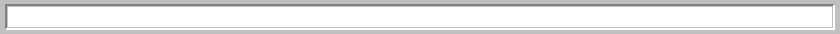

## ⭐ Flagship: FerroOS

**[FerroOS](https://github.com/anti-ghostsec/FerroOS)** is a hardened, privacy-first Linux that looks and feels like Windows 95, and still runs Steam, Proton and the whole Debian world.

- 🔒 Full-disk encryption, a duress PIN that destroys the keys, and no sleep mode that leaves keys in memory
- 🧅 Tor and VPN tools built in, programs sandboxed
- 🪶 A lean desktop written in Rust: window manager, file explorer, archive tool, sound enhancer, appearance settings
- 🎮 Native Vulkan and OpenGL, Steam/Proton, NVIDIA and CUDA when you want them

[**Download the ISO →**](https://github.com/anti-ghostsec/FerroOS/releases)

## 🧰 Apps

Each one is small, starts fast, never phones home, and works on its own or as part of FerroOS.

| | Project | What it does |
|:-:|---|---|
| 🌐 | **[Wisp](https://github.com/anti-ghostsec/wisp)** | A small, privacy-focused web browser on WebKitGTK and GTK 4, with plugins |
| 💬 | **[Whisker](https://github.com/anti-ghostsec/whisker)** | A Matrix client: every account signed in at once, hidden alt accounts, encrypted vaults |
| 📝 | **[Folio](https://github.com/anti-ghostsec/folio)** | A calm text editor: writing first, code second, remembers nothing |
| 📄 | **[Leaflet](https://github.com/anti-ghostsec/leaflet)** | PDFs and documents: read, fill in, annotate, edit DOCX/ODT, with no metadata left behind |
| 🎬 | **[CutFrame](https://github.com/anti-ghostsec/CutFrame)** | A light video editor in Rust, growing towards a full timeline |
| 🗄️ | **[Enclave](https://github.com/anti-ghostsec/Enclave)** | An encrypted file vault for Android, with no internet permission at all |

## 🧅 Networks without a company in the middle

| | Project | What it does |
|:-:|---|---|
| 🛡️ | **[The Sentinel Protocol](https://github.com/anti-ghostsec/The-Sentinel-Protocol)** | A social network, messenger and rooms in one app, over Tor, run by volunteers |
| 🍩 | **[Torus](https://github.com/anti-ghostsec/Torus)** | Build a website and host it as an onion service from your own PC or phone |

## 🔎 Tools

| | Project | What it does |
|:-:|---|---|
| 🤖 | **[AnonCode](https://github.com/anti-ghostsec/AnonCode)** | An encryption-first AI coding agent with an encrypted project vault |
| 🖼️ | **[BetterSearch](https://github.com/anti-ghostsec/BetterSearch)** | Desktop booru search with boolean queries and an encrypted local vault |
| 🌙 | **[Nuba](https://github.com/anti-ghostsec/nuba)** | A fast anime tracker with its own accounts, no email, and no JavaScript needed |
| ⬇️ | **[vidgrab](https://github.com/anti-ghostsec/vidgrab)** | A LibreWolf/Firefox add-on that downloads videos through yt-dlp |

## 🧭 How everything here is built

- **Nothing leaves your machine unless you ask.** No telemetry, no analytics, no update pings behind your back.
- **No traces in your files.** Saved documents, photos and videos are stripped of author names, dates, GPS and program versions.
- **Light by design.** Most of it runs comfortably on a 1 GB machine.
- **Verifiable releases.** Builds come from public CI, with checksums or signatures you can check.
- **Honest about limits.** Every README says what a project doesn't do yet.

## 🐍 Activity

<picture>
  <source media="(prefers-color-scheme: dark)" srcset="https://raw.githubusercontent.com/anti-ghostsec/anti-ghostsec/output/snake-dark.svg">
  <source media="(prefers-color-scheme: light)" srcset="https://raw.githubusercontent.com/anti-ghostsec/anti-ghostsec/output/snake.svg">
  
</picture>

*If one of these is useful to you, a ⭐ helps other people find it.*

